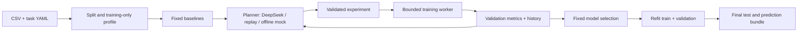

# Tabular Lab Agent

A personal learning project for autonomous, reproducible classification experiments.
One controller proposes an experiment, observes validation results, and chooses the next experiment.
The evaluator owns data splitting, scoring, model selection, and resource limits.

**V1** uses validated experiment specifications from a shared model registry.
**V2** adds generated Python pipelines inside restricted Docker Linux containers.
V1 runs on Windows without Docker. CatBoost optionally uses an NVIDIA GPU; other V1 estimators use CPU.

This project is under active development. Offline/mock demonstrations are explicitly labeled and do not
establish the benefit of an LLM. Live DeepSeek comparisons require your own API key.

Local real-data references (3 seeds, 12 completed runs, no API calls):

| Dataset | Fixed baseline macro-F1 | Random search macro-F1 |
| --- | ---: | ---: |
| Wine Quality (three classes) | 0.5547 ± 0.0144 | 0.5883 ± 0.0138 |
| Adult | 0.7815 ± 0.0000 | 0.8078 ± 0.0103 |

Fixed baselines use 2 candidates; random search uses 8. See the
[full results and figure](examples/benchmark-local/README.md) and [validation status](docs/VALIDATION.md).



## Quick start (Windows, Python 3.11)

From the repository root, using [uv](https://docs.astral.sh/uv/):

```powershell
uv venv --python 3.11
uv pip install --python .venv/Scripts/python.exe -r requirements-dev.txt
uv pip install --python .venv/Scripts/python.exe -e . --no-deps
.\.venv\Scripts\python.exe -m tabular_lab prepare --dataset demo
.\.venv\Scripts\python.exe -m tabular_lab run --task configs/example.yaml
```

Alternatively create a Python 3.11 venv and install with `python -m pip install -r requirements-dev.txt`
and `python -m pip install -e . --no-deps`. On Linux use `.venv/bin/python` in place of the Windows path.

The example runs **five offline experiments with no API calls**, then writes a unique directory under
`runs/`. Use its printed path for prediction:

```powershell
.\.venv\Scripts\python.exe -m tabular_lab predict --model runs/<run_id>/model --input data/demo.csv --output runs/predictions.csv
```

Prediction needs no API key. It includes the fitted preprocessing and original target labels. An ID
column is retained when configured. Features are reordered by name; missing/extra feature columns fail
with an explicit schema error. A target column, if present, is ignored during prediction.
Load only trusted native `.joblib` models: pickle-based artifacts execute code when loaded.

## Real datasets and GPU training

```powershell
.\.venv\Scripts\python.exe -m tabular_lab prepare --dataset wine-quality
.\.venv\Scripts\python.exe -m tabular_lab prepare --dataset adult
# A real-data run without an LLM or API bill:
.\.venv\Scripts\python.exe -m tabular_lab run --task configs/wine-quality.yaml --provider mock --device auto
```

- **Wine Quality**: combine red/white data, include wine type, remove duplicate original rows, define
  `low <= 5`, `medium = 6`, `high >= 7` before experimentation, and remove the original quality score
  from features. Repeated feature vectors remain in the same split. See [UCI](https://archive.ics.uci.edu/dataset/186/wine+quality).
- **Adult**: preserve the official test set. Remove development examples whose feature vectors overlap
  with test data, deduplicate development features, and take 20% of the remaining development data as a
  fixed stratified validation set. This intentionally differs from the unmodified training protocol.
  No test labels are used to perform this overlap check. See [UCI](https://archive.ics.uci.edu/dataset/2/adult).
- `demo`, `breast-cancer`, and `wine` are small offline regression datasets; sklearn Wine is **not**
  Wine Quality.

Preparation saves source URLs, archive SHA-256, cleaning policy and attribution under `data/`.
Data and model artifacts are gitignored. Both UCI datasets are CC BY 4.0; the code license does not
replace dataset licenses. Downloads use official archives, are cached, and are not extracted to disk.

`--device cpu` is the default. `auto` tries CatBoost on GPU when `nvidia-smi` is available and retries the
same candidate on CPU if GPU training fails; `gpu` requests GPU without that fallback. The real-data
configs use `auto`. Each successful trial records `device_used`; worker logs record fallback. GPU
floating-point reductions can be nondeterministic, so fixed seeds do not imply bit-identical GPU runs.
No PyTorch/CUDA toolkit installation is needed for V1's CatBoost GPU path.

## Live DeepSeek and replay

Set the key in your own terminal; `.env` is an example only and is not loaded automatically:

```powershell
$env:DEEPSEEK_API_KEY = "your-key"
.\.venv\Scripts\python.exe -m tabular_lab run --task configs/wine-quality.yaml --provider deepseek
```

Default model: `deepseek-flash`; change it and the pricing snapshot together in task YAML. We record
the model returned by the provider as well as the configured alias. The alias can change server-side;
a recorded response replay is the way to reproduce decisions without another API call.

The planner receives training summary statistics and validation history, not raw rows, file paths,
dataset names or test scores. V1 candidates come from `tabular_lab/search.py` so random search and the
LLM use the **same finite space**. The LLM supplies an evidence-based hypothesis and chooses the next
candidate. Unsupported parameters, repeats and out-of-space proposals are rejected. Three consecutive
invalid plans stop search. JSON syntax errors are billed before retrying; unknown usage stops calls.

For replay, set `llm.provider: replay` and `llm.replay_path: ../runs/<original>/events.jsonl`.
Replay makes no paid call and records original usage separately from its zero new API cost.
The seed, data, search space and software versions must match for comparable results.

### Limits and accounting

Defaults: 20 CNY/run, 30 minutes, 8 total candidates (including two baselines), 120 seconds/trial,
120 seconds/finalization, 4 CPU workers. All are configurable under `limits`. Finalization time is
reserved from the search window. Child processes are terminated on timeout. If refitting fails, the
already-fitted best training-only model is retained and the run is marked partial.

Each call reserves conservative UTF-8 input bytes plus overhead and the maximum output length, then
records actual `prompt_tokens` and `completion_tokens`. The checked-in **2026-10-26** snapshot uses
USD 0.30/M input and USD 1.20/M output, ignoring cache/off-peak discounts, and an **assumed** 7.20 CNY/USD.
These produce conservative cost estimates, not provider invoices or a live FX rate. Check
[official pricing](https://api-docs.deepseek.com/quick_start/pricing/) before live runs. API errors or
missing usage are marked unknown and halt subsequent requests; they are never reported as free.
The local budget controller cannot enforce an account-wide provider spending limit.

## Benchmarking

```powershell
# Real-data fixed baseline and random-search references: no API calls
.\.venv\Scripts\python.exe -m tabular_lab benchmark --suite configs/benchmark-local.yaml
# Add live LLM comparisons after setting your key (multiple runs incur separate budgets)
.\.venv\Scripts\python.exe -m tabular_lab benchmark --suite configs/benchmark.yaml
```

Both suites use seeds 17/42/73 and matching task configurations. Fixed baselines run two candidates;
random search and the Agent receive up to eight candidates, including those same two baselines.
Do not interpret the fixed reference's lower compute usage as an equal-budget search comparison.
Adult's externally prepared split is fixed; seeds change estimator/search randomness. Wine Quality's
internal split and estimator/search randomness change with the seed.

Each run uses only validation scores for selection; test scores appear after the winning candidate is
frozen. Suite outputs are `results.csv`, `results.json`, and `aggregate.csv` (mean/std across seeds).
Report runtime, cost and failures alongside scores; an LLM is not guaranteed to beat random search.
If changing the system after inspecting benchmark test scores, treat those scores as development
feedback and use a fresh held-out task for a new generalization claim.

## Artifacts

Every `runs/<run_id>/` contains `config.json`, `manifest.json`, `profile.json`, `splits.json`,
`events.jsonl`, `experiments.json`, `summary.json`, `report.md`, private trial artifacts and an exported
`model/`. Successful final evaluation also writes `test_predictions.csv`. The manifest records code
state, package versions, data hashes, seeds and the pricing snapshot. Split indices are zero-based rows
in the prepared CSV files, not the original UCI archives.

Run status is `completed`, `partial` or `no_model`; CLI returns a nonzero status for partial/no-model
runs. A missing API key can still yield useful baseline models but is marked partial, never a completed
LLM experiment. Aggregate only comparable successful runs and inspect failures separately.

Curate a run for GitHub explicitly with `publish-example --run <path> --output examples/<name>`.
This exports selected summaries, experiments, manifest and report; raw data, full API logs, absolute
local paths and binary models stay private. Review custom experiment hypotheses before publication.

## V2: generated pipelines (Docker required)

```powershell
docker build -t tabular-lab-worker:0.1.0 -f docker/Dockerfile .
.\.venv\Scripts\python.exe -m tabular_lab docker-check
.\.venv\Scripts\python.exe -m tabular_lab run --task configs/codegen.yaml
```

Generated source implements `build_pipeline(seed, feature_schema)` returning a classifier pipeline.
The controller can pass sanitized exception type/stack locations back for up to two repairs per
candidate; **every executed repair also consumes a trial slot**. Baselines and final selection stay
under the trusted evaluator. Generated code can extend features and models; the finite V1 search-space
comparison does not apply to V2.

Containers use an immutable local image ID, a nonroot user, no network/capabilities, read-only root,
limited CPU/memory/processes/time, a temporary filesystem and mounts for this candidate only. Training
data/labels and validation features are available; validation labels remain on the host, and test
features are mounted only after selection. No API key or Docker socket is mounted. Generated models
are loaded only inside containers; the host reads checked numeric predictions and computes metrics.
Container cleanup explicitly removes timed-out containers. This is a local learning boundary, not a
service hardened to execute adversarial submissions.

V2 defaults to CPU containers and does not require GPU passthrough. Docker is currently an optional
prerequisite; `docker-check` explains missing setup and V1 remains usable. End-to-end V2 and live LLM
validation must be recorded separately from static/unit checks.

## Tests and learning

```powershell
.\.venv\Scripts\python.exe -m pytest -q
.\.venv\Scripts\python.exe -m ruff check .
# After building the Docker image:
.\.venv\Scripts\python.exe -m pytest -m docker -q
```

Normal tests use mocked HTTP, consume no API quota, and exercise data separation, unseen categories,
strict schemas, budget stops, unknown usage, subprocess timeout, exported prediction and failure
recovery. The actual Docker integration test skips with an explicit reason if its prerequisites are
missing. CI builds the container on Linux and runs that integration test separately.

Start with the Chinese [learning guide](docs/LEARNING.zh-CN.md), [architecture](docs/ARCHITECTURE.md),
[dataset roadmap](docs/DATASETS.md), and [AI usage statement](docs/AI_USAGE.md).

## License

MIT for this repository's code. Public datasets and model providers retain their own licenses/terms.
