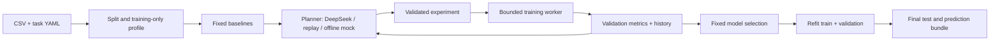

# Tabular Lab Agent

A personal learning project for autonomous, reproducible classification experiments.
One controller proposes an experiment, observes validation results, and chooses the next experiment.
The evaluator owns data splitting, scoring, model selection, and resource limits.

**V1** uses validated experiment specifications from a shared model registry.
**V2** adds generated Python pipelines inside restricted Docker Linux containers.
V1 runs on Windows without Docker. CatBoost optionally uses an NVIDIA GPU; other V1 estimators use CPU.

Optional local inputs now include image classification, character-hash text classification and mixed
image/text/tabular features. Fixed descriptors feed the same evaluator and model search; they do not
provide a vision-language model, OCR or object detection. No pretrained weights or paid service is
needed for the supplied synthetic examples. See the [multimodal guide](docs/MULTIMODAL.zh-CN.md).

Windows/Linux offline CI, local Windows Docker integration and Linux Docker integration have passed.
Live DeepSeek V1 experiments and V2 generated pipelines have completed on public datasets. V2 has
been checked on a synthetic demo, Wine Quality and Adult, including reloading exported models in new
processes. Local V2 use requires Docker Desktop with a Linux engine.

This project is under active development. Offline/mock demonstrations are explicitly labeled and do not
establish the benefit of an LLM. Live DeepSeek comparisons require your own API key.

Completed V1 comparison (four datasets, three seeds, **36/36 completed runs**, zero failed candidates):

| Dataset | Fixed baseline macro-F1 | Random search macro-F1 | LLM Agent macro-F1 |
| --- | ---: | ---: | ---: |
| Breast Cancer | 0.9843 ± 0.0054 | 0.9843 ± 0.0054 | 0.9843 ± 0.0054 |
| Wine | 0.9903 ± 0.0168 | 0.9903 ± 0.0168 | 0.9903 ± 0.0168 |
| Wine Quality | 0.5547 ± 0.0144 | 0.5883 ± 0.0138 | 0.5850 ± 0.0079 |
| Adult | 0.7815 ± 0.0000 | 0.8078 ± 0.0103 | 0.8143 ± 0.0004 |

Fixed baselines use two candidates; random search and the Agent share the same finite registry and
eight-candidate ceiling. The 12 live Agent runs made 74 API calls at an estimated total CNY 0.926923.
The Agent tied the small-data baselines, slightly trailed random search on Wine Quality, and had a
higher mean on Adult. Three seeds support a descriptive comparison, not a general superiority claim.
See [all results, costs, failure rates and figure](examples/benchmark-full/README.md), the
[independent audit](examples/benchmark-full/audit.json), and [validation status](docs/VALIDATION.md).



## Quick start (Windows, Python 3.11)

From the repository root, using [uv](https://docs.astral.sh/uv/):

```powershell
uv venv --python 3.11
uv pip install --python .venv/Scripts/python.exe -r requirements-dev.txt
uv pip install --python .venv/Scripts/python.exe -e . --no-deps
.\.venv\Scripts\python.exe -m tabular_lab prepare --dataset demo
.\.venv\Scripts\python.exe -m tabular_lab run --task configs/example.yaml
```

Alternatively create a Python 3.11 venv and install with `python -m pip install -r requirements-dev.txt`
and `python -m pip install -e . --no-deps`. On Linux use `.venv/bin/python` in place of the Windows path.

The example runs **five offline experiments with no API calls**, then writes a unique directory under
`runs/`. Use its printed path for prediction:

```powershell
.\.venv\Scripts\python.exe -m tabular_lab predict --model runs/<run_id>/model --input data/demo.csv --output runs/predictions.csv
```

Prediction needs no API key. It includes the fitted preprocessing and original target labels. An ID
column is retained when configured. Features are reordered by name; missing/extra feature columns fail
with an explicit schema error. A target column, if present, is ignored during prediction.
Load only trusted native `.joblib` models: pickle-based artifacts execute code when loaded.

## Real datasets and GPU training

```powershell
.\.venv\Scripts\python.exe -m tabular_lab prepare --dataset wine-quality
.\.venv\Scripts\python.exe -m tabular_lab prepare --dataset adult
# A real-data run without an LLM or API bill:
.\.venv\Scripts\python.exe -m tabular_lab run --task configs/wine-quality.yaml --provider mock --device auto
```

- **Wine Quality**: combine red/white data, include wine type, remove duplicate original rows, define
  `low <= 5`, `medium = 6`, `high >= 7` before experimentation, and remove the original quality score
  from features. Repeated feature vectors remain in the same split. See [UCI](https://archive.ics.uci.edu/dataset/186/wine+quality).
- **Adult**: preserve the official test set. Remove development examples whose feature vectors overlap
  with test data, deduplicate development features, and take 20% of the remaining development data as a
  fixed stratified validation set. This intentionally differs from the unmodified training protocol.
  No test labels are used to perform this overlap check. See [UCI](https://archive.ics.uci.edu/dataset/2/adult).
- `demo`, `breast-cancer`, and `wine` are small offline regression datasets; sklearn Wine is **not**
  Wine Quality.

Preparation saves source URLs, archive SHA-256, cleaning policy and attribution under `data/`.
Data and model artifacts are gitignored. Both UCI datasets are CC BY 4.0; the code license does not
replace dataset licenses. Downloads use official archives, are cached, and are not extracted to disk.

`--device cpu` is the default. `auto` tries CatBoost on GPU when `nvidia-smi` is available and retries the
same candidate on CPU if GPU training fails; `gpu` requests GPU without that fallback. The real-data
configs use `auto`. Each successful trial records `device_used`; worker logs record fallback. GPU
floating-point reductions can be nondeterministic, so fixed seeds do not imply bit-identical GPU runs.
No PyTorch/CUDA toolkit installation is needed for V1's CatBoost GPU path.

## Live DeepSeek and replay

On Windows, save your key once using hidden input. Subsequent runs, including new terminals, read it
from Windows Credential Manager for the current user:

```powershell
.\.venv\Scripts\python.exe -m tabular_lab auth login
```

Run `auth login` only for initial setup or when replacing your key. After that, start experiments from
any new terminal without entering the key again:

```powershell
.\.venv\Scripts\python.exe -m tabular_lab run --task configs/wine-quality.yaml --provider deepseek
```

`auth status` checks local availability without revealing the key or calling the API and exits non-zero
when none is configured; `auth logout` deletes the saved credential. An explicitly set `DEEPSEEK_API_KEY`
takes priority over the saved key. `python scripts/verify_credentials.py` confirms that the stored key
reaches the request header using a local mock transport, so it makes no network request.
Linux/CI use that environment variable; `.env` files are not loaded automatically. Keys are never
written to task YAML or experiment logs, and generated-code containers receive no credentials.
The Windows store protects persistent storage; applications running as your Windows user can read it.

Default model: `deepseek-flash`; change it and the pricing snapshot together in task YAML. We record
the model returned by the provider as well as the configured alias. The alias can change server-side;
a recorded response replay is the way to reproduce decisions without another API call.

The planner receives training summary statistics and validation history, not raw rows, file paths,
dataset names or test scores. V1 candidates come from `tabular_lab/search.py` so random search and the
LLM use the **same finite space**. The LLM supplies an evidence-based hypothesis and chooses the next
candidate. Unsupported parameters, repeats and out-of-space proposals are rejected. Three consecutive
invalid plans stop search. JSON syntax errors are billed before retrying; unknown usage stops calls.

For replay, set `llm.provider: replay` and `llm.replay_path: ../runs/<original>/events.jsonl`.
Replay makes no paid call and records original usage separately from its zero new API cost.
The seed, data, search space and software versions must match for comparable results.

### Limits and accounting

Defaults: 20 CNY/run, 30 minutes, 8 total candidates (including two baselines), 120 seconds/trial,
120 seconds/finalization, 4 CPU workers. All are configurable under `limits`. Finalization time is
reserved from the search window. Child processes are terminated on timeout. If refitting fails, the
already-fitted best training-only model is retained and the run is marked partial.

Each call reserves conservative UTF-8 input bytes plus overhead and the maximum output length, then
records actual `prompt_tokens` and `completion_tokens`. The checked-in **2026-10-26** snapshot uses
USD 0.30/M input and USD 1.20/M output, ignoring cache/off-peak discounts, and an **assumed** 7.20 CNY/USD.
These produce conservative cost estimates, not provider invoices or a live FX rate. Check
[official pricing](https://api-docs.deepseek.com/quick_start/pricing/) before live runs. API errors or
missing usage are marked unknown and halt subsequent requests; they are never reported as free.
The local budget controller cannot enforce an account-wide provider spending limit.

## Benchmarking

```powershell
# Real-data fixed baseline and random-search references: no API calls
.\.venv\Scripts\python.exe -m tabular_lab benchmark --suite configs/benchmark-local.yaml
# Add live LLM comparisons after setting your key (multiple runs incur separate budgets)
.\.venv\Scripts\python.exe -m tabular_lab benchmark --suite configs/benchmark.yaml
# Full release-validation matrix: 4 datasets x 3 seeds x 3 strategies
.\.venv\Scripts\python.exe -m tabular_lab prepare --dataset all
.\.venv\Scripts\python.exe -m tabular_lab benchmark --suite configs/benchmark-full.yaml
```

All suites use seeds 17/42/73 and matching task configurations. Fixed baselines run two candidates;
random search and the Agent receive up to eight candidates, including those same two baselines.
Do not interpret the fixed reference's lower compute usage as an equal-budget search comparison.
Adult's externally prepared split is fixed; seeds change estimator/search randomness. Wine Quality's
internal split and estimator/search randomness change with the seed.

Each run uses only validation scores for selection; test scores appear after the winning candidate is
frozen. Suite outputs are `results.csv`, `results.json`, and `aggregate.csv` (mean/std across seeds).
Report runtime, cost and failures alongside scores; an LLM is not guaranteed to beat random search.
Audit local completed V1 runs without loading model objects or making API calls:

```powershell
.\.venv\Scripts\python.exe scripts/verify_benchmark.py --input runs/benchmark-full
```

If changing the system after inspecting benchmark test scores, treat those scores as development
feedback and use a fresh held-out task for a new generalization claim.

## Artifacts

Every `runs/<run_id>/` contains `config.json`, `manifest.json`, `profile.json`, `splits.json`,
`events.jsonl`, `experiments.json`, `summary.json`, `report.md`, private trial artifacts and an exported
`model/`. Successful final evaluation also writes `test_predictions.csv`. The manifest records code
state, package versions, data hashes, seeds and the pricing snapshot. Split indices are zero-based rows
in the prepared CSV files, not the original UCI archives.

Run status is `completed`, `partial` or `no_model`; CLI returns a nonzero status for partial/no-model
runs. A missing API key can still yield useful baseline models but is marked partial, never a completed
LLM experiment. Aggregate only comparable successful runs and inspect failures separately.

Curate a run for GitHub explicitly with `publish-example --run <path> --output examples/<name>`.
This exports selected summaries, experiments, manifest and report; raw data, full API logs, absolute
local paths and binary models stay private. Review custom experiment hypotheses before publication.

## V2: generated pipelines (Docker required)

Configure the key once as described in [Live DeepSeek and replay](#live-deepseek-and-replay).
From the repository root, prepare the demo and build the worker image once, then start a small live run:

```powershell
.\.venv\Scripts\python.exe -m tabular_lab prepare --dataset demo
docker build -t tabular-lab-worker:0.1.0 -f docker/Dockerfile .
.\.venv\Scripts\python.exe -m tabular_lab docker-check
.\.venv\Scripts\python.exe -m tabular_lab auth status
.\.venv\Scripts\python.exe -m tabular_lab run --task configs/codegen-smoke.yaml
```

The last command makes paid API requests. The smoke configuration uses an estimated **CNY 1 budget**,
a **300-second run budget**, and **at most five candidates**, including two fixed baselines.
The remaining three slots include generated attempts and repairs; the Agent may stop earlier.
Each training attempt and final refit is limited to 60 seconds. Containers use 4 CPUs and 8 GB memory.
Docker preflight, cleanup and file export can add overhead beyond the run budget.
`configs/codegen.yaml` remains available with the general run defaults described above.

Generated source implements `build_pipeline(seed, feature_schema)` returning a classifier pipeline.
The controller can pass sanitized exception type/stack locations back for up to two repairs per
candidate; **every executed repair also consumes a trial slot**. Baselines and final selection stay
under the trusted evaluator. Generated code can extend features and models; the finite V1 search-space
comparison does not apply to V2.
Subsequent proposals receive the best successful generated source and its validation metrics, in
addition to failure feedback and execution limits. Syntax failures return line/offset without raw messages.

Containers use an immutable local image ID, a nonroot user, no network/capabilities, read-only root,
limited CPU/memory/processes/time, a temporary filesystem and mounts for this candidate only. Training
data/labels and validation features are available; validation labels remain on the host, and test
features are mounted only after selection. No API key or Docker socket is mounted. Generated models
are loaded only inside containers; the host reads checked numeric predictions and computes metrics.
Container cleanup explicitly removes timed-out containers. This is a local learning boundary, not a
service hardened to execute adversarial submissions.

V2 defaults to CPU containers. `--device auto` probes GPU access inside the worker image and enables
GPU access when available, otherwise using CPU. `--device gpu` requires a successful container GPU
probe and fails before planning when unavailable. GPU access permits CPU estimators too; generated
code chooses the estimator's training device. A GPU training error goes back to the repair loop;
the executor does not rewrite the source to force a CPU retry. Check availability without API calls:

```powershell
.\.venv\Scripts\python.exe -m tabular_lab docker-check --device gpu
```

Add `--device auto` to a V2 `run` command to enable this policy. The planner receives GPU availability
and CPU/memory limits. Candidates and exported bundles record the resolved container device, which
is restored for finalization and prediction using the immutable image ID. GPU-enabled bundles currently
require GPU access during prediction; older bundles without a device record retain CPU behavior.
The container's memory limit controls host RAM, not GPU VRAM. GPU access and actual GPU training are
different facts; reports record availability without claiming every generated estimator used the GPU.
Docker is optional for V1; `docker-check` explains missing setup and V1 remains usable.
See the Chinese [GPU configuration walkthrough](docs/V2_GPU.zh-CN.md) for the module-by-module flow.

The worker now writes bounded, schema-validated fitted-model runtime metadata. It recognizes CatBoost's
fitted `task_type`, supported sklearn CPU estimators and common pipeline/wrapper/ensemble relationships;
unsupported estimators are `unknown`. Records enter trial history, planner feedback and exported models.
GPU availability alone is never treated as observed GPU training, and CPU use alone does not prove fallback.

CatBoost early stopping uses the installed `tabular_lab.early_stopping.EarlyStoppingCatBoost` helper:
split only the current fit data internally, fit preprocessing on the inner fitting fold, select iterations
on the inner monitoring fold, then refit preprocessing and the estimator on all current fit data. The
selected learning rate is preserved and both training stages consume the same trial timeout. Detected
direct CatBoost overfitting detectors outside this helper are rejected as `UnverifiedEarlyStoppingError`;
fixed-iteration CatBoost remains supported. Rebuild the worker image after updating these modules.
See the Chinese [runtime and early-stopping walkthrough](docs/EARLY_STOPPING.zh-CN.md).

### Verified live V2 runs (2026-10-26–27)

These runs used real DeepSeek responses and actual Docker execution. Every run executed two fixed
baselines and three generated candidates, then selected and exported a generated pipeline:

| Dataset | Test macro-F1 | Failed candidates | API calls | Seconds | Estimated CNY |
| --- | ---: | ---: | ---: | ---: | ---: |
| Synthetic demo | 0.922995 | 2 | 3 | 32.2 | 0.026672 |
| Wine Quality | 0.613178 | 1 | 4 | 69.3 | 0.061325 |
| Adult | 0.814883 | 0 | 3 | 83.8 | 0.034288 |
| Additional memory-validation demo | 0.879464 | 1 | 4 | 44.0 | 0.038528 |

All 72 / 1,064 / 16,281 exported test predictions were reproduced by new processes inside Docker.
The original demo's CatBoost failures were reproduced and traced to default file output in a read-only
working directory. The executor now uses writable bounded `/tmp` scratch, while the root remains
read-only; a regression test covers default CatBoost output. The successful third demo attempt changed
estimator, so it did not demonstrate a fix of that specific error by the LLM.

These are single-seed functional validations, not evidence of general repair ability or a matched-budget
V1/V2 comparison. Failed attempts remain in the records. A run-level `completed` status alone is
insufficient: check that a generated candidate actually succeeded, since baselines may still succeed
when all generated attempts fail. See [public V2 records and generated source](examples/live-v2/README.md),
[validation status](docs/VALIDATION.md), and the Chinese [first-run guide](docs/V2_FIRST_RUN.zh-CN.md).

For real-data V2 runs, use `configs/codegen-wine-quality.yaml` or `configs/codegen-adult.yaml` after
preparing the relevant dataset. Both use a CNY 1 estimated budget, five candidates and a ten-minute
run budget. V2's generated candidate space is broader than the finite V1 registry.

On Windows, the application also checks the standard per-user and all-users Docker Desktop locations
when `docker` is absent from an older terminal's PATH. Reopen PowerShell if you want to use the bare
`docker` command directly after installation.

## Tests and learning

The current working tree adds full-window planning admission, untried canonical V1 candidate IDs with
rejection feedback, and bounded custom-member runtime audits. See the Chinese
[implementation walkthrough](docs/ENGINEERING_HARDENING.zh-CN.md) and [validation status](docs/VALIDATION.md).
The historical counts below describe the 0.2.0 release; they are not the latest working-tree totals.
The latest local verification passed **136 distinct tests with no skips**, executed in two disjoint groups:
125 offline and eleven actual Docker tests, including two GPU cases. This is local verification; check
GitHub Actions for the published commit's CI status. See the [delivery walkthrough](docs/EXTENDED_INPUTS_DELIVERY.zh-CN.md).

Recorded local Windows verification: **49 passed, 0 skipped** (45 offline tests and four actual Docker
integration tests). A separate Linux container passed all **45 offline tests**. Docker coverage includes
train/export/predict, replay-driven repair, CatBoost scratch output and timed-out container cleanup.

```powershell
.\.venv\Scripts\python.exe -m pytest -q
.\.venv\Scripts\python.exe -m ruff check .
# After building the Docker image:
.\.venv\Scripts\python.exe -m pytest -m docker -q
```

Normal tests use mocked HTTP, consume no API quota, and exercise data separation, unseen categories,
strict schemas, budget stops, unknown usage, subprocess timeout, exported prediction and failure
recovery. The actual Docker integration test skips with an explicit reason if its prerequisites are
missing. CI builds the container on Linux and runs that integration test separately.

Start with the Chinese [learning guide](docs/LEARNING.zh-CN.md), [architecture](docs/ARCHITECTURE.md),
[dataset roadmap](docs/DATASETS.md), and [AI usage statement](docs/AI_USAGE.md).
The next guided session is outlined in [the Chinese code-reading plan](docs/NEXT_SESSION.zh-CN.md).
See the [four-stage acceptance record](docs/ACCEPTANCE.zh-CN.md) and [release notes](CHANGELOG.md).

New offline entry points:

```powershell
.\.venv\Scripts\python.exe -m tabular_lab prepare --dataset image-demo
.\.venv\Scripts\python.exe -m tabular_lab run --task configs/image-demo.yaml
.\.venv\Scripts\python.exe -m tabular_lab prepare --dataset multimodal-demo
.\.venv\Scripts\python.exe -m tabular_lab inspect --task configs/multimodal-demo.yaml
.\.venv\Scripts\python.exe -m tabular_lab run --task configs/multimodal-demo.yaml
```

Benchmark outputs are protected against accidental overwrites. A read-only `benchmark --dry-run`
previews configured runs, and `--resume` checks the frozen source/data/environment/image protocol,
skips saved runs and refuses incomplete or unknown-usage work. See the
[resume guide](docs/BENCHMARK_RESUME.zh-CN.md). Real API calls and the old V1/V2 comparison remain paused.

## License

MIT for this repository's code. Public datasets and model providers retain their own licenses/terms.
