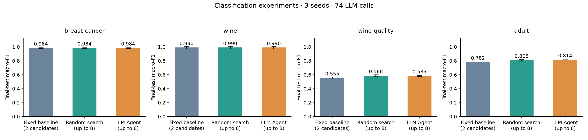

# Classification benchmark

Seeds: [17, 42, 73]; 74 LLM calls; estimated total cost CNY 0.926923. Fixed baselines use two candidates; random search and the V1 Agent share the same finite candidate space and up to eight candidates per run. All use the same split/seed protocol and resource ceilings. Mock/replay records are not live calls.

| Dataset | Strategy | Seeds | Test macro-F1 mean ± std | Mean seconds | Mean CNY | Trial failure rate |
| --- | --- | ---: | ---: | ---: | ---: | ---: |
| adult | agent | 3 | 0.8143 ± 0.0004 | 93.0 | 0.074138 | 0.0% |
| adult | baseline | 3 | 0.7815 ± 0.0000 | 15.3 | 0.000000 | 0.0% |
| adult | random | 3 | 0.8078 ± 0.0103 | 90.6 | 0.000000 | 0.0% |
| breast-cancer | agent | 3 | 0.9843 ± 0.0054 | 63.2 | 0.089226 | 0.0% |
| breast-cancer | baseline | 3 | 0.9843 ± 0.0054 | 17.5 | 0.000000 | 0.0% |
| breast-cancer | random | 3 | 0.9843 ± 0.0054 | 58.1 | 0.000000 | 0.0% |
| wine | agent | 3 | 0.9903 ± 0.0168 | 67.1 | 0.070456 | 0.0% |
| wine | baseline | 3 | 0.9903 ± 0.0168 | 16.8 | 0.000000 | 0.0% |
| wine | random | 3 | 0.9903 ± 0.0168 | 62.8 | 0.000000 | 0.0% |
| wine-quality | agent | 3 | 0.5850 ± 0.0079 | 80.9 | 0.075154 | 0.0% |
| wine-quality | baseline | 3 | 0.5547 ± 0.0144 | 15.9 | 0.000000 | 0.0% |
| wine-quality | random | 3 | 0.5883 ± 0.0138 | 59.5 | 0.000000 | 0.0% |

Wine Quality is our predefined three-class task after duplicate handling. Adult preserves the official test with a cleaned development set. GPU trials may show small numerical differences across reruns. See ../../docs/DATASETS.md for exact protocols.

Manifests record each run's actual commit, dirty state, source hash and package versions. Early development runs may honestly have a null commit. Failed/partial runs remain in results.csv but are excluded from the score means above. Test metrics are used only after validation-based selection; repeated development on these tasks limits generalization claims. Public reports are rendered from the recorded summaries; raw logs remain private. Tests and validation jobs ran concurrently, so recorded runtimes are indicative rather than controlled speed measurements. Three seeds support a descriptive comparison, not a significance claim.
