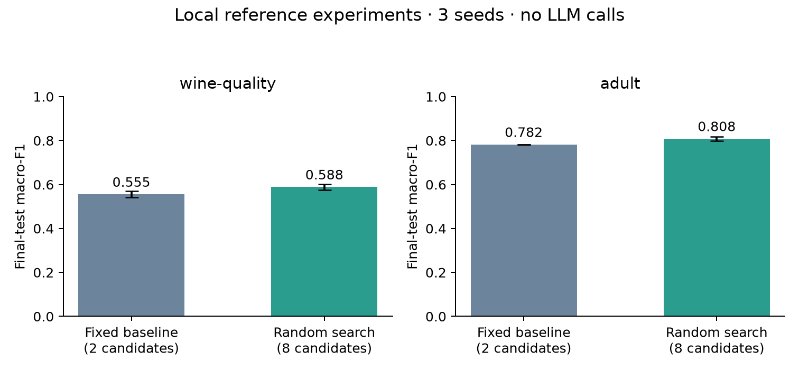

# Local reference benchmark

Three seeds (17, 42, 73); no LLM calls or API cost. Fixed baselines use two candidates; random search uses up to eight. These are reference experiments, not evidence of LLM effectiveness.

| Dataset | Strategy | Seeds | Test macro-F1 mean ± std | Mean seconds |
| --- | --- | ---: | ---: | ---: |
| adult | baseline | 3 | 0.7815 ± 0.0000 | 11.4 |
| adult | random | 3 | 0.8078 ± 0.0103 | 81.9 |
| wine-quality | baseline | 3 | 0.5547 ± 0.0144 | 9.7 |
| wine-quality | random | 3 | 0.5883 ± 0.0138 | 59.2 |

Wine Quality is our predefined three-class task after duplicate handling. Adult preserves the official test with a cleaned development set. GPU trials may show small numerical differences across reruns. See ../../docs/DATASETS.md for exact protocols.

These first development runs began before the initial Git commit, so their manifests honestly contain a null commit. The V1 experiment/data/search code is included with this release. Future runs record the current commit and package-source hash.
